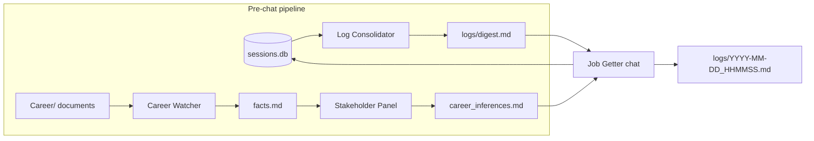

# AgentWorkshop

A place for me to learn and practice **harness engineering**: designing the
code, tools, memory, and orchestration around LLM agents rather than just the
prompts.

The working project inside it is **Job Getter**, a terminal-based job-search
assistant built on the [OpenAI Agents SDK](https://openai.github.io/openai-agents-python/)
and the [Model Context Protocol (MCP)](https://modelcontextprotocol.io/). Before
every chat, a set of background agents reads my career documents, debates what
they say about me, and summarizes past conversations, so Job Getter starts
each session already knowing my background.

---

## How it works

Running `python agent.py` executes a fixed pipeline. Steps 1–3 always run
before the chat starts; they are not left to the model to decide.



1. **Log Consolidator**: folds any past Job Getter conversations from
   `sessions.db` that haven't been summarized yet into a running narrative,
   `logs/digest.md`.
2. **Career Watcher**: investigates documents in `Career/` that haven't been
   processed yet (PDF, DOCX, text). It records each finding with its evidence
   in `facts.md`. Progress is tracked in `processed_files.json`, so a run that
   hits its 60-turn limit resumes where it left off next time.
3. **Stakeholder Panel**: five role-playing agents and a Mediator debate
   `facts.md` and produce `career_inferences.md`, a catalogue of inferred
   skills and strengths, each with a confidence level and its evidence.
4. **Instruction refresh**: Job Getter's system prompt is rebuilt from
   `Career/profile.md` (if present), `career_inferences.md`, and
   `logs/digest.md`.
5. **Chat loop**: an interactive terminal conversation whose replies stream
   as they're generated. Each turn is persisted to `sessions.db`.
6. **Log**: on `quit`/`exit`, the transcript is written to
   `logs/<timestamp>.md`.

### The Stakeholder Panel

The panel is designed to avoid groupthink. See `Learning/Lessons3.md` and
`Learning/Lessons4.md`.

| Agent | Model | Lens |
|---|---|---|
| Recruiter | `gpt-5.6-luna` | Market signals, transferable experience, differentiators |
| Hiring Manager | `gpt-5.6-sol` | Practical execution, ownership, delivery |
| Technical Lead | `gpt-5.6-terra` | Technical depth, engineering practice, architecture |
| People & Leadership | `gpt-5.6-luna` | Communication, coordination, leadership |
| Executive | `gpt-5.6-sol` | Strategy, business judgment, leverage |
| Mediator | `gpt-5.6-terra` | Decides when to stop; writes the final synthesis |

- **Round 1:** each stakeholder reads the facts **independently**, in its own
  session, so no agent anchors on another's take.
- **Rounds 2+:** the Mediator returns a structured `PanelCheckpoint`
  (Pydantic) that says whether another round is worthwhile and, if so, poses
  one open question to the whole panel.
- **Synthesis:** the Mediator rewrites `career_inferences.md`, treating the
  previous version as provisional working memory rather than something to
  preserve.

Panel transcripts are stored in `intake_sessions.db`. Before each new run, the
Panel Consolidator summarizes previous runs into `logs/panel_digest.md`.

---

## Project layout

```
AgentWorkshop/
├── agent.py                 # Entry point: pipeline + Job Getter chat loop
├── career_watcher.py        # Career Watcher agent
├── career_watcher_skills.md # Recording process appended to Career Watcher's instructions
├── panel.py                 # Stakeholder Panel + Mediator (also runnable standalone)
├── log_consolidator.py      # Summarizes Job Getter chats -> logs/digest.md
├── panel_consolidator.py    # Summarizes panel runs -> logs/panel_digest.md
├── utils.py                 # stream_and_print(): prints streamed replies as they arrive
│
├── mcp_server.py            # MCP server for Job Getter (empty placeholder for future tools)
├── cw_mcp_server.py         # MCP tools for Career Watcher
├── lc_mcp_server.py         # MCP tools for Log Consolidator
├── pc_mcp_server.py         # MCP tools for Panel Consolidator
│
├── Career/                  # Source documents: resumes, cover letters, certifications, transcripts
├── Learning/                # Lessons learned from each build/debug session
└── logs/                    # Chat transcripts, digest.md, panel_digest.md
```

### Generated state

These files are created and updated by the agents. Delete them to start fresh.

| File | Written by | Purpose |
|---|---|---|
| `facts.md` | Career Watcher | First-pass facts and hedged inferences, each with its evidence |
| `career_inferences.md` | Mediator | Final career-knowledge catalogue fed to Job Getter |
| `processed_files.json` | `cw_mcp_server.py` | Career documents already investigated |
| `sessions.db` | Job Getter | Chat history (Agents SDK `SQLiteSession`) |
| `intake_sessions.db` | Panel | Panel discussion history |
| `consolidated_sessions.json` | `lc_mcp_server.py` | Chats already folded into `digest.md` |
| `panel_consolidated_sessions.json` | `pc_mcp_server.py` | Panel runs already folded into `panel_digest.md` |

---

## MCP servers

Each background agent gets its own MCP server, a separate Python process
launched over stdio by `MCPServerStdio`. They all follow the same resumable
pattern: **list new items → read → act → mark done**, with a JSON index so
interrupted runs pick up where they left off.

| Server | Tools |
|---|---|
| `cw_mcp_server.py` (`career`) | `list_career_documents`, `list_unprocessed_documents`, `read_document`, `mark_processed`, `save_candidate_fact` |
| `lc_mcp_server.py` (`log_consolidator`) | `list_unconsolidated_sessions`, `read_session`, `mark_consolidated`, `get_digest`, `save_digest` |
| `pc_mcp_server.py` (`panel_consolidator`) | `list_unconsolidated_panel_sessions`, `read_panel_session`, `mark_panel_session_consolidated`, `get_panel_digest`, `save_panel_digest` |
| `mcp_server.py` (`job_getter`) | *None yet*; kept connected for future tools such as job search |

> **Why MCP instead of `@function_tool`?** Partly for practice. MCP tools live in
> a standalone process that any MCP client (Claude Desktop, Copilot, etc.) can
> discover and call, while a `@function_tool` only exists inside one Python
> process. See `Learning/Lessons2.md` and `Learning/Lessons3.md`.

---

## Getting started

### Prerequisites

- Python 3.10+
- An OpenAI API key with access to the `gpt-5.6-*` models used above

### Setup

```powershell
python -m venv .venv
.\.venv\Scripts\Activate.ps1
pip install openai-agents mcp pypdf python-docx python-dotenv
```

Create a `.env` file in the repo root (it's git-ignored):

```
OPENAI_API_KEY=sk-...
```

### Run

```powershell
python agent.py
```

The pre-chat pipeline prints its progress (`Running Log Consolidator...`,
`Running Career Watcher...`, `Running Intake Panel...`). When it finishes,
chat at the `You:` prompt. Type `quit` or `exit` to end the session and save
the log.

To run only the Stakeholder Panel against the current `facts.md`:

```powershell
python panel.py
```

> **Note:** The panel runs on every `agent.py` launch, even when `facts.md`
> hasn't changed. With six agents and multiple rounds, startup can take a
> while and use a significant number of tokens.

---

## Learning notes

`Learning/` is a running journal of what each session taught me:

| File | Session focus |
|---|---|
| `Lessons2.md` | Workflows vs. agents, CoALA memory types, evals, MCP fundamentals |
| `Lessons3.md` | MCP in depth, async timing bugs, native tools vs. MCP, panel groupthink |
| `Lessons4.md` | Tracing, the shared-session bug, structured output with Pydantic |
| `Lessons5.md` | Debugging a self-reinforcing false-memory loop in the digest |
| `Lessons6.md` | Panel redesign: structured output limits, stopping criteria |

---

## Roadmap ideas

- Add real tools to `mcp_server.py` (job search, resume/cover-letter tailoring)
- Skip the panel when `facts.md` hasn't changed since the last run
- Feed `logs/panel_digest.md` back into the panel or Job Getter (currently written but not read)
- Add a `requirements.txt`
